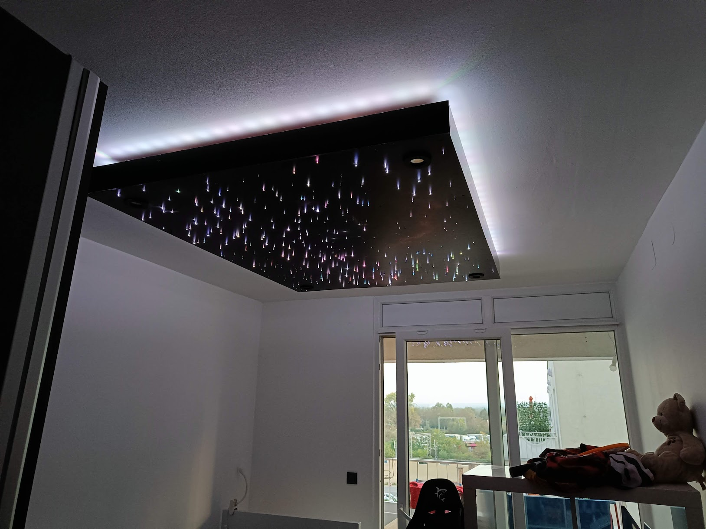

# Starry Sky Ceiling with Rain Sound Player Project

The home project for:

- keeping the CHINLY Bluetooth 16 W RGBW LED Fibre Optic Star Ceiling Lights Kit App connected and manageable with the
  Home Assistant.
- rain sound player using ESP32 and DFPlayer

# Idea #

The project started when my kid wanted a starry sky ceiling, like his friend had something similar implemented.
Engineer, like I am, started investigating different options and ideas how to make the ceiling as fancy as possible,
while at the same time thinking about a technical approach for the implementation.

Since the apartment had different "smart" thingies connected through the Home Assistant, the natural course was to
include everything manageable from the "smart" ceiling to the Home Assistant.



# Devices #

## Zigbee power switch ##

The live wire used for the ceiling has a Zigbee manageable switch to easily turn everything off, whether for the
inspection time, or during the vacation period. Zigbee has a strong and tight implementation within the Home Assistant,
nothing had to be developed.

## WLED strip ##

There's already a nice integration for the WLED on
the [Home Assistant](https://www.home-assistant.io/integrations/wled/). Not perfect, IMHO, with all these extra segments
and master light switch, but for the simple one-segment strip and tons of effects, it's excellent for the current usage
of the WLED strip.

## Starry sky ##

I bought
the [CHINLY Bluetooth 16 W RGBW LED Fibre Optic Star Ceiling Lights Kit App](https://www.amazon.de/dp/B08XJQM47T) from
Amazon.de. While the kit has a generic application for changing the light colors, and generic remote control, the kit
lacks any connectivity with the Home Assistant. The Internet knows about the kit, there are some integrations that try
to add the kit to the Home Assistant, but they are mostly capped by the string name the Kit exposes through BLE. Having
this kit exposing something completely different, there was no integration I could go of with.

The solution was inspecting the BLE stack between my phone and the kit. After writing everything to the Excel
file, finding patterns in the messages, I started writing message manipulation program with the C/C++ and YAML file for
calling the methods from the manipulation program using lambda calls.

The built binary is too heavy for standard ESP32, so I created the build for the ESP32-S3, but feel free to play with
other files

The BLE command format lives in [`stars/starsBLE.h`](stars/starsBLE.h). Every message is a 20-byte frame; the header
builds it from the light state (RGB or white), the effect number and the motor speed (0–4), and the YAML lambdas send it
to the kit's `0000ffb1` characteristic.

Home Assistant entities: `Stars` (RGBW light), `Stars Speed` (motor speed 0–4), `Stars connected` (BLE link state),
plus the shared `WiFi Signal dB` and `WiFi Signal Percent`.

## Rain sound player ##

A plain ESP32 (`esp32dev`) with a DFPlayer Mini on UART plays soundscapes from the SD card. Home Assistant gets a
`Select Sound` list, a `Volume` slider (0–30), a `Sleeping Master playing` sensor driven by the DFPlayer BUSY pin and a
status sensor. Each song has its own starting volume in the `sound_generator_initial_volume_per_song` global.

# Repository layout #

```
docker-compose.yaml          ESPHome container, mounts ./config as /config
config/
  starry-sky.yaml            Starry sky device (BLE bridge to the star ceiling kit)
  sounder.yaml               Rain sound player device (DFPlayer)
  base/
    common.yaml              Shared by both devices: Wi-Fi, fallback AP, captive portal, logger,
                             Wi-Fi signal sensors, Home Assistant API and OTA
    wifi_networks.yaml       Your Wi-Fi networks (git-ignored, copy from the .example file)
  stars/
    config.yaml              Starry sky identity and hardware: name, board, PSRAM, BLE MAC
    starsBLE.h               BLE command builder used from the YAML lambdas
  sounder/
    config.yaml              Sound player identity and hardware: name, board, UART and BUSY pins
  secrets.yaml               Shared secrets (git-ignored, copy from the .example file)
tests/
  starrySky.cpp              Unit tests for starsBLE.h
```

Each device YAML includes its own `config.yaml` first, then `base/common.yaml`. Anything specific to one device
(name, board, pins) goes in its `config.yaml`. Anything both devices need goes in `common.yaml`. Only real secrets go in
`secrets.yaml`.

# Setup #

## Wi-Fi Networks ##

Create a local network file from the example one:

```
cp config/base/wifi_networks.example.yaml config/base/wifi_networks.yaml
```

Edit `config/base/wifi_networks.yaml` and add as many networks as you need. Git ignores the file, so your credentials
stay local.

The build has access point mode enabled on the node. It starts when the device can't reach any known network for about a
minute. Default credentials are ssid: `SSC`, password: `ssc12345`. To change them for one device, add `ap_ssid` and
`ap_password` to that device's `config.yaml` substitutions.

## Secrets ##

```
cp config/secrets.yaml.example config/secrets.yaml
```

| Key                  | Used by     | What it is                                                         |
|----------------------|-------------|--------------------------------------------------------------------|
| `api_encryption_key` | all devices | Home Assistant API key (32 bytes, base64). OTA reuses the same key. |
| `mac_address`        | starry sky  | BLE MAC address of the star ceiling kit                            |

Generate a new API key with `openssl rand -base64 32`. Keep the existing one when you rebuild a device that is already
adopted, or Home Assistant will need to adopt it again.

## Device name ##

The name lives in the device's `config.yaml` (`name` and `friendly_name`). Don't change `name` on a device that is
already flashed: OTA updates and the `<name>.local` address depend on it. For a one-off build under a different name,
override it from the command line:

```
docker compose run --rm stars -s name 'starry-sky-ble' -s friendly_name 'Starry Sky BLE' compile starry-sky.yaml
```

# Building #

ESPHome runs in Docker, so nothing needs to be installed locally. The image version is set in `docker-compose.yaml`.

```
docker compose pull
docker compose run --rm stars config starry-sky.yaml     # validate
docker compose run --rm stars compile starry-sky.yaml    # build
```

Replace `starry-sky.yaml` with `sounder.yaml` for the sound player. `docker compose up -d` starts the ESPHome dashboard
on port 6052 instead.

# Flashing #

## Over the network (OTA) ##

When the device already runs firmware with the `ota:` block from `common.yaml`:

```
docker compose run --rm stars run starry-sky.yaml --device starry-sky-nash.local
```

An IP address works as well as the `.local` name.

## First flash, or firmware without OTA ##

- **USB:** plug the board in and use `--device /dev/ttyACM0` (or `/dev/ttyUSB0`). On WSL2, attach the port first with
  [usbipd-win](https://github.com/dorssel/usbipd-win): `usbipd list`, `usbipd bind --busid <id>`,
  `usbipd attach --wsl --busid <id>`. You can also flash `firmware.factory.bin` from a browser at
  https://web.esphome.io.
- **Captive portal:** if the device can't reach Wi-Fi, it starts its fallback access point. Connect to it, open
  `http://192.168.4.1` and upload `firmware.ota.bin`, or use
  `curl -F "update=@firmware.ota.bin" http://192.168.4.1/update`.

# Tests #

The BLE command builder has plain C++ unit tests:

```
g++ -std=c++17 -Wall tests/starrySky.cpp -o tests/starrySky && ./tests/starrySky
```
